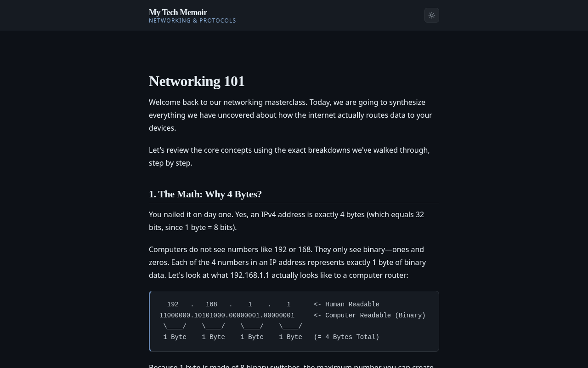

# My Tech Memoir

A personal blog about code, architecture and the craft of building software — a
reading site and a full authoring/admin app in one Next.js codebase, written in
English, Persian (RTL) and German.

**Live: [my-tech-memoir.vercel.app](https://my-tech-memoir.vercel.app)**



---

## What it is

Two halves of the same product, one App Router tree:

**Reading** — `/` (home), `/blog` (paginated list, tag filter), `/blog/[slug]`,
`/blog/tag/[slug]`, `/about`, `/bookmarks`. Posts render from a structured Tiptap
document rather than raw HTML: headings, tables, callouts, code blocks with
language and filename, figures with captions, and a click-to-zoom lightbox
(posts that predate that document fall back to their stored HTML). Readers can
comment (threaded replies) and bookmark, and every account carries its own
appearance preferences.

**Authoring** — `/admin`: post editor, comment moderation queue, media library,
tags, users, dashboard, appearance and settings.

## Features

### Reading experience

- **Three locales from one layout.** `en` (default), `fa` and `de`, with
  `directionFor(locale)` as the only source of direction — applied once on
  `<html>` and mirrored into Base UI's `DirectionProvider`. Logical CSS
  properties throughout, directional icons mirrored with `rtl:-scale-x-100`, and
  Vazirmatn swapped in for Arabic script since Geist and Lora stop at Latin.
- **Preferences with three layers.** Theme (`light` / `dark` / `system`), accent
  palette (default plus five), reading size, reading width and reduced motion. JS
  only writes attributes on `<html>`; every palette and scale lives in
  `globals.css`. A pre-paint script reads a cookie in `<head>` so there is no
  theme flash, and signed-in users are authoritative on the account row
  (`User.appearance`) — preferences follow you to another browser.
- **Comments with an auto-moderator.** A score is computed from signals (links,
  promotional phrasing, shouting, repetition, author trust) and mapped to
  `PENDING` / `APPROVED` / `REJECTED` / `SPAM`, with threaded replies, staff
  replies, bulk actions and moderation stats.
- **Bookmarks and view counts.** Per-account saves and a per-post view counter.

### Authoring

- **Tiptap 3 editor** with a bubble menu (bold, italic, strikethrough, inline
  code, link, text colour) and a slash / `Ctrl+K` command palette: headings,
  quotes, callouts, tables, code blocks, dividers, images.
- **Images end to end** — upload to Vercel Blob, then resize, align (full,
  centre, left, right or text-wrapped), caption, and lightbox in the post.
- **Markdown paste normalisation** — pasted Markdown is parsed, clamped to the
  app's heading model and re-nested, so a paste can never produce a document the
  API rejects on save.
- **Theme-aware text colours** — the palette's neutral swatches render as design
  tokens, so a sentence styled "Ink" stays readable in both themes while the
  stored document keeps its hex.
- **Sticky editor chrome, scroll controls and server-side tag search**, with
  dirty-aware saving and a structured document (`contentJson`) kept alongside
  the rendered HTML.
- **Moderation, media, users and a dashboard** with bucketed trends
  (week / month / year) rendered with Recharts.

## Tech stack

| Area | Choice |
|---|---|
| Framework | Next.js 16 (App Router, React Server Components) |
| UI | React 19, Base UI + shadcn/ui primitives, Tailwind CSS 4 |
| Language | TypeScript 5.8, `strict` |
| Design system | CSS custom properties in `globals.css` — light and dark, accent palettes, reading scale |
| i18n | next-intl 4 — locale routing, direction, per-locale copy |
| Database | PostgreSQL on Neon, Prisma 7 (`@prisma/adapter-neon`) |
| Auth | Auth.js v5 (NextAuth) with the Prisma adapter — GitHub and Google OAuth, JWT sessions, `USER` / `EDITOR` / `ADMIN` |
| Editor | Tiptap 3 — StarterKit, TextStyle/Color, Link, Image, Table, Typography, CodeBlockLowlight |
| Client data | TanStack Query 5, TanStack Table 8, Recharts 3 |
| Media | Vercel Blob |
| Tooling | `tsx` scripts, `happy-dom`, ESLint 9 |

## Architecture

A layered, domain-first structure: a component calls a hook, the hook calls a
client service, the service calls a route handler, the handler calls a server
service, the service calls a repository, and only the repository touches Prisma.
Nothing skips a layer, and dependencies point inward.

```
src/features/<domain>/
  components/   UI                 server/<x>-repository.ts   Prisma → DTO
  hooks/        TanStack Query     server/<x>-service.ts      business rules
  services/     client API calls   types/                     request/response DTOs
```

Domains: `blog`, `comments`, `bookmarks`, `tags`, `users`, `admin`,
`appearance`, `about`, `auth`.

**[docs/ARCHITECTURE.md](docs/ARCHITECTURE.md)** covers the layering, the
pagination and filter contracts, server rendering vs. client fetching, the
appearance and moderation pipelines, error handling, and the RTL rules.

## Getting started

**Prerequisites:** Node.js ≥ 20.9 (the Next.js 16 requirement), npm, and a
PostgreSQL database — [Neon](https://neon.tech) is what this repo targets.

```bash
git clone https://github.com/KoushyarHB/my-tech-memoir.git
cd my-tech-memoir
npm install                 # postinstall runs prisma generate into ./generated/prisma
cp .env.example .env        # then fill in the values below
npx prisma migrate deploy   # apply the migrations in prisma/migrations
npm run dev                 # http://localhost:3000 → redirects to /en
```

### Environment

| Variable | Purpose |
|---|---|
| `DATABASE_URL` | Neon pooled connection string |
| `DIRECT_URL` | Non-pooled connection, used for migrations |
| `AUTH_SECRET` | Auth.js secret (`npx auth secret`) |
| `AUTH_GITHUB_ID` / `AUTH_GITHUB_SECRET` | GitHub OAuth app — callback `/api/auth/callback/github` |
| `AUTH_GOOGLE_ID` / `AUTH_GOOGLE_SECRET` | Google OAuth client — callback `/api/auth/callback/google` |
| `BLOB_READ_WRITE_TOKEN` | Vercel Blob token, required for editor image uploads |
| `NEXT_PUBLIC_SITE_URL` | Canonical site URL for metadata (falls back to the Vercel domain) |

Signing in with GitHub or Google creates a `USER`. To get into `/admin`, promote
yourself once — after you have signed in at least once:

```bash
npm run promote-admin -- you@example.com
```

### Scripts

| Script | What it does |
|---|---|
| `npm run dev` / `build` / `start` | Develop, build for production, run the production server |
| `npm run lint` | ESLint (flat config, zero warnings) |
| `npm run db:check` | Prints post, tag and user counts for the configured database |
| `npm run promote-admin -- <email>` | Grants `ADMIN` to an existing user |
| `npm run seed` | One-off import of the original static posts — a no-op now that the content lives in the database |
| `npm run db:backfill-content-json` | Backfills `Post.contentJson` from legacy HTML; dry-run unless you pass `--apply` |

### Verification

There is no unit-test runner in this repo. Instead, every contract worth
protecting has a script that fails loudly — and most of them need no database:

| Script | Covers |
|---|---|
| `npm run verify:query` | Pagination parsing, filter grammar, the Prisma `where` it generates |
| `npm run verify:dashboard` | Dashboard bucketing: counts, contiguity, week/month/year alignment, labels |
| `npm run verify:filters` | The relation filter grammar and the filter control's placeholder/clear affordances |
| `npm run verify:appearance` | Preference parsing and migration, the pre-paint script against a fake DOM, cookie round-trips |
| `npm run verify:moderation` | The auto-moderator's signals, scoring, clamping and status transitions |
| `npm run verify:markdown` | Markdown paste → document → save → render (headings, nesting, hydration safety) |
| `npm run verify:colors` | Text colours stay theme-aware across the renderer, the editor mark and the API validator |
| `npm run verify:about` | The locale contract: every key in every locale, no copy reused across locales |
| `npm run verify:skeleton` | Loading skeletons stay in step with the components they stand in for |
| `npx tsc --noEmit` / `npm run lint` / `npm run build` | Types, lint and a production build |

Optional live checks — these write to the configured database, so point `.env`
somewhere deliberate before running them:
`npx tsx --env-file=.env scripts/verify-appearance-live.ts`,
`verify-moderation-live.ts`, `verify-tags-filter-live.ts`,
`verify-dashboard-live.ts`.

## Deployment

The site runs on Vercel with a Neon Postgres database and a Vercel Blob store;
pushes to `main` deploy automatically. Set every variable from the table above in
the project's environment, and make sure the OAuth callbacks and
`NEXT_PUBLIC_SITE_URL` point at the deployed domain.

## Docs

- [docs/ARCHITECTURE.md](docs/ARCHITECTURE.md) — how the app is put together
- [docs/pre/](docs/pre) — the specification, conventions and build plan the project was written from
- [docs/drafts/](docs/drafts) — article drafts

## License

MIT